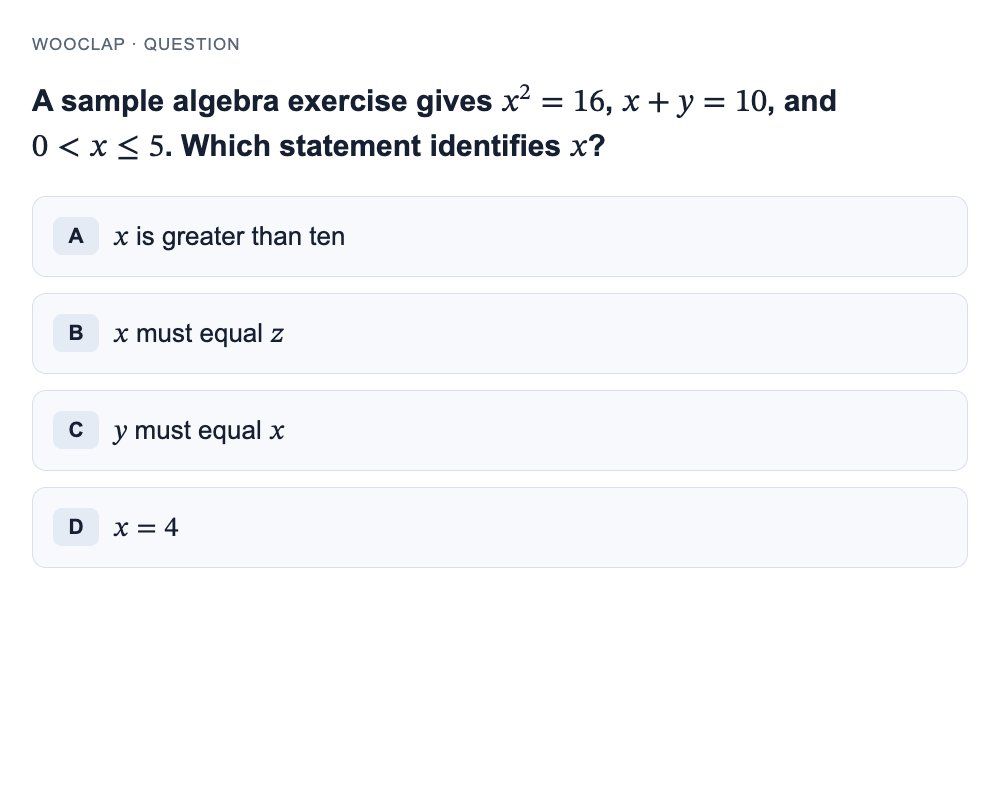

# NTULearn Wooclap → Telegram

[](https://github.com/HappyCool121/ntulearn-wooclap-monitor/actions/workflows/ci.yml)

Monitor a Wooclap session embedded in your logged-in NTULearn Chrome tab. Receive immediate image alerts in a private Telegram chat or group. Optionally append a Luna suggested answer and brief reasoning to the same alert with `watch --suggestions`.

- Checks the selected session every **10 seconds**.
- Captures the original question and answer choices without scrolling or changing your lecture tab.
- Recreates a readable card from the question's MathML if native capture fails or would cut off content.
- Suppresses repeated alerts for an unchanged question and reports prolonged monitoring outages.
- Optionally generates suggestions with the authenticated local Codex CLI using `gpt-6-luna`. Each delivered question finishes even if newer questions appear.
- Automatically saves groups that add the bot and broadcasts alerts to them, alongside your configured private chat.
- Telegram answer submission is deferred: no answer buttons, answer reply handling, or browser submission starts during watching.
- Detection uses deterministic DOM inspection. Suggestions use inference; no Telegram webhook or hosted server is required.



This repository publishes the source code. Run the monitor on a computer with your own logged-in Chrome session and your own Telegram bot. GitHub does not run the lecture watcher for you. By default, **every group or supergroup that adds the bot receives future alerts**, alongside the configured private destination. All destinations receive the same lecture session being monitored on your computer. Individual `/subscribe` commands and channels are not supported. Use `watch --no-auto-groups` for the original single configured destination behavior.

## Requirements

- Node.js **22 or newer**, with npm.
- Recent Google Chrome with `chrome://inspect/#remote-debugging` available, or an existing local Chrome DevTools Protocol endpoint.
- A logged-in NTULearn tab displaying the embedded Wooclap session.
- A Telegram account and a bot created through [BotFather](https://t.me/BotFather).
- For optional suggestions (`watch --suggestions`), a recent [Codex CLI](https://learn.chatgpt.com/docs/cli) on `PATH`, with `codex login` completed and access to `gpt-6-luna`. The CLI must support `--no-daemon`, `--ephemeral`, and `--ignore-user-config`. No separate API key is needed when using saved ChatGPT authentication. Basic `watch` works without Codex; `--no-suggestions` is also accepted.

Tested locally on macOS. Suggestion process-group cleanup targets macOS/Linux. CI runs unit tests on Node 22/24 and isolated Chrome browser tests on Linux. Chrome channel attachment depends on your installed Chrome version and profile. The tool's default target host is `ntulearn.ntu.edu.sg`; standalone Wooclap tabs and other learning systems are not selected.

## Install

```bash
git clone https://github.com/HappyCool121/ntulearn-wooclap-monitor.git
cd ntulearn-wooclap-monitor
npm ci
```

Normal monitoring uses your installed Chrome, so it does not require downloading Playwright's bundled Chromium.

## Configure Telegram once

1. Open [BotFather](https://t.me/BotFather), send `/newbot`, and follow its prompts. The username must end in `bot`.
2. Keep the returned bot token private.
3. Open your new bot's chat and send `/start`.
4. Run:

   ```bash
   node src/cli.js setup
   ```

5. Paste your token into the hidden local prompt. Setup validates the bot, discovers private chats and groups, lets you choose when several match, saves configuration, and sends a test message.

Settings are stored outside the repository at `~/.config/ntulearn-wooclap-monitor/config.json`, with `0600` file permissions on POSIX systems. Environment variables can override them. Setup reuses existing settings. Use `setup --select-chat` to choose another destination, or `setup --chat <id>` to set an explicit numeric ID. Group IDs are negative. Environment variables continue to override saved settings.

Sending `/start` privately is a one-time setup step; it does not subscribe additional individual users. Groups register automatically while the watcher or group listener runs. Use a dedicated bot: setup and automatic registration preserve existing webhooks rather than removing another service's configuration. See [Telegram's official tutorial](https://core.telegram.org/bots/tutorial) for bot creation.

## Send alerts to a group

1. Add your bot to the Telegram group. If invitations are disabled, enable `/setjoingroups` in [BotFather](https://t.me/BotFather).
2. Start the watcher with `npm start -- --suggestions` (or `npm start` for basic alerts).
3. The group receives a connection message when registered, then future question and outage alerts. Add the bot to more groups to register those too. There is no need to run `setup --select-chat` for each group.

Privacy mode can stay enabled. The bot needs permission to send messages and photos. Removing or kicking the bot unregisters the group. Groups and their update offsets are saved with owner-only permissions in a bot-specific `groups-<hash>.json` beside the local configuration file. They survive restarts; group membership is checked at startup. The configured private chat continues receiving alerts. A configured group is imported into this registry automatically on its first run. Supergroup migrations update registered IDs automatically.

The bot can be added while your computer is offline. Telegram retains pending membership updates for **at most 24 hours**. If the join happened earlier, send `/start@YourBotUsername` in the group while the listener is running (for this bot: `/start@wooclapper_bot`). That verifies current bot membership and registers the group. Registration adds only future questions; it does not replay previous alerts. See [Telegram's update delivery documentation](https://core.telegram.org/bots/api#getting-updates).

To register groups without Chrome or an active lecture, run:

```bash
node src/cli.js listen-groups
```

This keeps receiving group changes and sending connection messages until Ctrl+C. Stop it before starting the watcher: only one watcher/listener should poll a bot at a time. A receiver lock prevents overlapping local processes using the same configuration directory; a Telegram polling conflict stops the watcher/listener. Existing webhooks are never removed. Dry runs do not register groups, contact Telegram, or generate suggestions. `watch --once` processes pending group changes before its one check and drains all deliveries and edits.

For a single explicit destination, continue using `setup --select-chat` or `setup --chat <id>`, then run `watch --no-auto-groups`. Stop any watcher/listener before interactive destination discovery. Setup validates access and rejects channels.

## Connect your Chrome tab

1. In Chrome, open `chrome://inspect/#remote-debugging`.
2. Enable **Allow remote debugging for this browser instance**.
3. Open your lecture in NTULearn and enter its Wooclap activity.
4. Run the checks below and approve Chrome's connection prompt if shown:

   ```bash
   node src/cli.js doctor
   node src/cli.js tabs
   ```

Playwright 1.64 attaches through `chromium.connectOverCDP('chrome', { noDefaults: true })`. It uses the existing login and leaves browser context settings alone. It does not read login credentials, copy cookies, or automate authentication.

For another configured local endpoint:

```bash
node src/cli.js --endpoint http://127.0.0.1:9222 tabs
```

The tool does not enable debugging or open a debugging port itself. An automation connection used by another application is separate from this standalone tool's connection. See [Playwright's connection guidance](https://playwright.dev/mcp/configuration/browser-extension).

## Run for each lecture

```bash
# Optional: inspect detection and images without Telegram or Codex calls.
node src/cli.js watch --dry-run

# Start core notifications without inference; stop with Ctrl+C.
node src/cli.js watch

# Opt in to Luna answer suggestions.
node src/cli.js watch --suggestions
```

Exactly one matching session is selected automatically. If several tabs match, choose one interactively. Confirm the lecture title and session code in the initial `watching` line.

To select explicitly, use a code or 1-based index from `tabs`:

```bash
node src/cli.js watch --session ABCDEF
node src/cli.js watch --tab 2
```

`ABCDEF` is a placeholder; replace it with your own session code. The index refers to a fresh `tabs` listing. If multiple tabs have the same code, use the index or interactive selection. After a disconnect, the tool only reacquires the selected session; it does not switch lectures automatically.

Start the watcher again for later lectures. Keep Chrome, the session tab, the terminal process, and your computer running and awake. On macOS you can prevent idle system sleep while watching:

```bash
caffeinate -i node src/cli.js watch
```

This does not prevent sleep when you close the laptop lid. Closing Terminal stops monitoring. If no matching session is open at startup, the command exits with an error; open it first, then rerun. `Ctrl+C` leaves your browser and tabs open and closes only the monitor's owned renderer.

## Luna suggested answers

Suggestions are **off by default**. Use `watch --suggestions` (or `npm start -- --suggestions`) to enable them. The initial status reports `suggestions` and `remoteAnswers: false`. Existing bot/chat settings still work; no configuration migration is needed. Restart an existing watcher to load the change. `--read-only` is still accepted as a compatibility flag; it does not turn suggestions off.

Each question alert is sent first with `Suggested answer: generating…`. Once Telegram confirms delivery, a single background worker runs the local Codex CLI with **`gpt-6-luna`**, the captured question JPEG when available, extracted question text, and ordered choices. Luna returns the answer first and one or two short sentences of reasoning, with explicit uncertainty when information is insufficient. Suggestions consume your Codex inference usage/credits under your sign-in plan; see [model availability](https://learn.chatgpt.com/docs/models) and [pricing](https://learn.chatgpt.com/docs/pricing). The model is pinned; unavailable Luna access never causes a switch to another model.

Each question is generated once after its first confirmed delivery. The worker shares the result across all delivered copies, including copies delivered after generation finishes, using a caption edit or a text edit for fallback notices. Edits are bound to both the chat ID and original message ID. The lecture, session, timestamp, and link stay intact. Output is plain text and safely truncated within Telegram's 1,024-character caption or 4,096-character message limit. Every question alert includes the public repository link. Suggestion-enabled alerts also show `Model: gpt-6-luna` and `AI suggestion; may be incorrect. Verify before use.` in generating, successful, and unavailable states. Space for the footer is reserved before truncating the answer. Newer questions do not cancel older generation jobs, and late results always update their own original messages.

At most 100 jobs may be outstanding, with duplicate delivery receipts suppressed by alert ID. Missing CLI/authentication, generation errors, empty or oversized output, a 60-second timeout, or a full generation queue produce `Suggested answer unavailable.` while ordinary alerts continue. If image capture fails, usable extracted text can still produce a suggestion; an image-only question without a usable image cannot. Edits reuse delivery retries, honor rate limits, and treat an unchanged message as success. A permanent edit failure is logged without resending the question or regenerating its answer. An edit rejected because the delivery queue is full is also logged; its original placeholder may remain.

Every generation runs in a private temporary directory. Its JPEG is stored with owner-only permissions. Codex runs without the shared daemon, ignores user configuration/rules, and disables shell execution, hooks, apps, plugins, subagents, and web search. `--ephemeral` suppresses saved session rollout files. Final output is captured in memory (64 KiB maximum); stderr is drained separately with only a bounded, redacted diagnostic tail retained. Shared authentication and existing Codex history are preserved. See [Codex non-interactive behavior](https://learn.chatgpt.com/docs/non-interactive-mode).

On success, failure, timeout, overflow, or shutdown, the worker closes its owned process and removes its temporary directory before scheduling any edit. If necessary it terminates only its own process group, escalating from SIGTERM to SIGKILL after two seconds, including descendants that ignore SIGTERM. Ctrl+C/SIGTERM cancels active generation, discards pending jobs, and waits for cleanup. It leaves your Chrome tabs open. `watch --once` drains initial delivery, generation, and resulting edits before exiting. Dry runs never invoke Codex or Telegram; `--no-suggestions` never invokes Codex.

Telegram submission is currently disabled. The answer controller, receiver, and browser submission helpers remain in the source for future work, but ordinary watching starts none of the answer handling and exposes no submission controls. Its Telegram group listener handles membership changes and group registration only. Read the suggestion and enter any chosen response yourself in Wooclap.

## Commands

| Command | Behavior |
| --- | --- |
| `setup` | Hidden local token entry, private/group discovery, save settings, send test alert |
| `doctor` | Check config, Telegram bot/chat access, Chrome, and matching tabs; send no messages |
| `tabs` | List NTULearn tabs with embedded Wooclap sessions |
| `listen-groups` | Save group joins/removals without Chrome; send connection messages |
| `watch` | Register groups and broadcast question/outage alerts without inference |
| `watch --no-auto-groups` | Send only to the configured chat; do not poll group updates |
| `watch --suggestions` | Append optional Luna suggestions with model attribution and disclaimer |
| `watch --no-suggestions` | Send basic alerts without Codex inference |
| `watch --read-only` | Compatibility flag; submission is disabled in every watch mode |
| `watch --dry-run` | Run detection and image capture without Telegram or Codex calls |
| `watch --once` | One check, finish delivery, suggestions, and edits, then exit |
| `--help` | Show commands and flags |

Global flags: `--config <path>`, `--endpoint <channel-or-url>`, `--json`.
Watch flags: `--session <code>`, `--tab <number>`, `--interval <seconds>`, `--read-only`, `--suggestions`, `--no-suggestions`, `--no-auto-groups`, `--dry-run`, `--once`.

The default interval is 10 seconds; overrides must be at least one second. Checks do not overlap, so a slow read or capture can extend an interval.

## Configuration

Environment variables override saved settings. Explicit endpoint/interval flags override both.

| Variable | Purpose |
| --- | --- |
| `TELEGRAM_BOT_TOKEN` | Bot token, configured locally |
| `TELEGRAM_CHAT_ID` | Numeric private/group chat ID (groups are negative) |
| `NTULEARN_MONITOR_CONFIG` | Alternate config JSON path |
| `NTULEARN_CDP_ENDPOINT` | Chrome channel or existing CDP URL; default `chrome` |
| `NTULEARN_POLL_SECONDS` | Check interval; default `10` |

`config.example.json` documents the file shape and contains placeholders only. Keep live credential files outside this repository. Tokens are redacted from tool diagnostics; credential URLs are not printed.

Optional command installation:

```bash
npm link
ntulearn-watch --help
```

## Images and reliability

- A question already active at startup alerts immediately. Repeated checks of that question do not alert again. An observed waiting/results state rearms detection for another appearance.
- Visible question IDs take precedence for deduplication. Otherwise the tool hashes normalized content, excluding standalone timers and response counts. Loading and disconnection do not clear duplicate-suppression history.
- Native screenshots use direct Chrome capture to avoid element stability waits. They cover the question panel or Wooclap main area and may include any response visible there. Images are held in memory for alerts and temporarily written to the private generation directory when suggestions run.
- If native capture fails, is obscured, or would cut off content, a controlled headless renderer creates a question card from an immutable semantic snapshot. KaTeX's MathML is retained once, including fractions, powers, and inequalities. Recreated images are labeled in the caption.
- The renderer supports text/MathML questions. Image/video/unsupported graphical questions require a successful native screenshot; unsupported graphics are not silently omitted from recreated cards. The renderer blocks scripts and external resource requests.
- Native capture has a 2-second deadline, fallback rendering 5 seconds, and the combined image operation 8 seconds. Images are checked against Telegram photo limits.
- Each successful alert contains one image and a short lecture/time/link caption. Suggestions add a placeholder followed by the generated answer in the same message. If both image paths fail, or Telegram rejects the photo, a concise notice links to Wooclap. Detailed errors and alert IDs stay in Terminal.
- Delivery is queued independently of polling. Transient errors retry up to five times per part with backoff; Telegram rate limits are honored. Confirmed parts are not resent. A lost acknowledgment can still cause a duplicate, so exactly-once delivery is not guaranteed.
- The in-memory queue holds at most 100 destination deliveries/edits. Group broadcasts share one serial worker; one destination failing does not discard other destinations, but retries and Telegram rate limits can delay later recipients. Overflow is logged and excess deliveries are not queued. Stopping discards pending deliveries and deduplication history. Restarting on an active question sends a fresh alert.
- After 60 seconds of unreadable/loading checks, the tool queues one outage notice and later one recovery notice. Network loss may also prevent those notices from arriving.
- Questions or waiting/reopen transitions entirely between checks can be missed. Sleep, offline Chrome, expired login, and DOM changes can interrupt detection. There is no historical question recovery.
- The event link contains no login query parameters. Opening it on another device may require joining or signing in there.

## JSON output

`--json` emits one JSON object per line with an `event` field. It never returns credentials.

```bash
node src/cli.js --json doctor
node src/cli.js --json tabs
node src/cli.js --json watch --session ABCDEF --dry-run --once
```

`doctor` returns `ready` and separate Telegram/Chrome checks. Its exit code is 1 when setup or a matching tab is missing. `tabs` returns a `tabs` array. `watch` emits selection, check, question, delivery, health, and `suggestion-queued`/`suggestion-started`/`suggestion-completed`/`suggestion-failed` events. Generation events include the alert ID, with duration and failure category on completion. Group registration emits `groups-listening`, `group-registered`, `group-removed`, retry/failure, and migration events. The initial `watching` event includes `remoteAnswers: false`, `suggestions`, and `automaticGroups`; question events include `screenshot`, `imageSource` (`native` or `recreated`), and capture diagnostics. Runtime failures emit an `error` event and exit nonzero. CLI argument/help/version output is handled by the parser; interactive setup does not support `--json`.

## Development and tests

```bash
npm ci
npm run check
npm test
npm run test:browser
```

Browser tests need installed Chrome. On a development/CI machine without Chrome, install it with:

```bash
npx playwright install --with-deps chrome
```

Unit tests cover state transitions, deduplication, configuration permissions, Telegram payloads/retries, suggestion limits, Unicode truncation, delayed edits, immutable question binding, image/text fallback, and a fake Codex executable. Worker tests exercise stdin/image input, ordering, duplicate receipts, missing CLI/auth, nonzero/empty/oversized output, queue saturation, timeouts, cancellation, and removal of temporary files and SIGTERM-ignoring process groups. Tests for the preserved submission/receiver helpers also remain. Browser tests use isolated temporary Chrome profiles and synthetic intercepted NTULearn/Wooclap pages. They cover frames, screenshots, MathML, successful submission, manual selections, changed/reordered questions, duplicate labels, custom radio controls, uncertain acknowledgment, and Ctrl+C. CLI tests use fake Codex and Telegram to verify default watching, edit retries, `--once` draining, `--dry-run`, `--read-only`, opt-in `--suggestions`, automatic group destinations, `--no-auto-groups`, and `--no-suggestions`, with no answer receiver or browser submission. Group tests cover saved membership and offsets, offline updates, joins/removals, migrations, startup verification, group start recovery, exclusive polling, webhook preservation, and shared suggestions across multiple chats with identical message IDs. They do not use a real NTULearn account or send Telegram messages. All quiz examples and the preview image are synthetic.

To regenerate the synthetic preview:

```bash
NTULEARN_TEST_PREVIEW=docs/example-question.jpg npm run test:browser
```

Wooclap DOM changes may require updates to `src/detection.js`. A local live Luna smoke test using the synthetic JPEG in this repository returned the correct answer and left no job-owned temporary files. Suggestions may be incorrect; review them before entering your response in Wooclap.

## License

[MIT](LICENSE).
